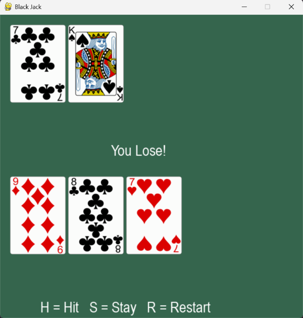

# Blackjack

A simple Blackjack card game in Python with a graphical window made in Pygame. You play against the dealer: get closer to 21 than the dealer without going over.



## How to play

| Key | Action |
| --- | ------ |
| **H** | Hit: take another card |
| **S** | Stay: keep your hand; the dealer reveals the hidden card and draws until reaching at least 17 |
| **R** | Restart: shuffle and deal a new round |

- Number cards count as their number, J/Q/K count as 10, and an Ace counts as 11 or 1, whichever helps.
- If you go over 21 you bust and lose right away.
- The result (**You Win!**, **You Lose!** or **Tie!**) appears in the middle of the table.

## Running it

Requires Python 3 and [pygame-ce](https://pypi.org/project/pygame-ce/).

```bash
python -m venv venv
venv\Scripts\activate
pip install pygame-ce
python black-jack-pygame.py
```

On Windows you can also just double-click `run.bat` after the first-time setup above.

Run the game from inside the project folder, because the card images are loaded from the `cards` folder by relative path.

## Project files

- `black-jack-pygame.py`: the full game
- `black-jack-pygame-starter-code.py`: a minimal starting point
- `cards/`: the card images
- `run.bat`: one-click launcher for Windows

## Credits

Built by following Kenny Yip Coding's [Black Jack in Python with Pygame](https://youtu.be/oyoRdXHWZiE) tutorial ([original repo](https://github.com/ImKennyYip/black-jack-python)).
